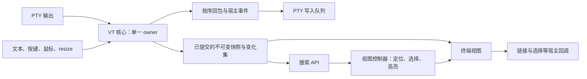

# Terminal 组件改进设计

状态：实施中；完成证据与剩余工作见 [实现进度](implementation-progress.md)。基线：`d990f72`，Scoop `0.0.0-dev.20261126`。更新：2026-11-26。

## 1. 目标与范围

把现有 `scoop.terminal.emulator` 和 `scoop.ui.terminal` 完善为可嵌入、可无窗口回放、适合真实 TUI 的终端组件。终端负责协议、内容、定位、绘制和直接交互；应用负责围绕终端组织工作空间。

| 本轮组件能力 | 完成范围 |
| --- | --- |
| 核心正确性 | 主屏及历史 reflow、Unicode/宽字符、VT 状态恢复、能力查询、传统键鼠编码、样式与光标 |
| 现代协议 | 同步输出、OSC 颜色查询、OSC 8 超链接、OSC 52 文本剪贴板 |
| 轻量 shell 元数据 | OSC 7 工作目录、OSC 133 命令边界及可选分割线；OSC 9;4 只产生进度状态和事件 |
| 直接交互 | 字符/词/逻辑行/矩形选择、边缘自动滚动、复制策略、字体连字 |
| 搜索 | 查询 API、分页结果、取消、定位、可见高亮、失效通知 |
| 图形 | Sixel 和 Kitty graphics 的静态图片传输、存储、放置、删除、滚动及绘制；具体兼容范围见第 9 节 |
| 性能 | 有界增量解析、行级变化、共享快照、按需排版、独立装饰层、缓存及可复现测量 |

搜索框、搜索按钮、结果列表、标签页、分屏布局、会话管理、命令面板和桌面通知 UI 属于上层。组件基础验收通过后，再在 demo 接这些功能。图形显示属于终端内容，OSC 133 分割线属于终端内的可选装饰，两者不增加外围工具 UI。

Kitty **键盘**协议与 Kitty **图形**协议是不同工作项；本轮先补传统输入正确性，不把键盘扩展混入图形任务。完整 shell 自动注入、命令重新执行、命令折叠和命令工具栏也不在本轮范围内。

### 1.1 当前代码与改动起点

现有核心已支持基本 VT 编辑、主备屏、历史、颜色、UTF-8/字素、粘贴和鼠标输入，UI 已接通真实 PTY、IME 和基本选择。改进以这些功能为基础：

| 当前实现 | 本设计对应改动 |
| --- | --- |
| `screen.scoop` resize 裁切物理行，无正文 reflow | 增加逻辑行和锚点，修复缩窄后再变宽丢字的问题 |
| `parser.scoop` 只派发标题 OSC，DCS/APC 被忽略 | 增加有界控制串处理及协议模块 |
| `csi.scoop` 丢弃带中间字节的序列 | 补齐模式、查询和样式的正确解析 |
| `view.scoop` 以 24 ms 静默 / 96 ms 最长期限合并输出 | 改为依据帧调度增量发布，避免持续输出时刷新率受该期限限制 |
| `glyphs.scoop` 按 cell 排版，缓存到上限后整体替换 | 改为行内 run、网格校验和局部缓存淘汰 |

现有 Scoop graphics 已有 GPU 渲染及字体 fallback；本设计优化组件的数据流和排版，不另造图形后端。

## 2. 架构与公共边界

继续保留两个生产 Cone。`emulator` 不依赖窗口、GPU、剪贴板或文件系统；`terminal-ui` 负责 PTY、时钟、平台服务和渲染。协议解析与 Sixel 像素算法用 Scoop 实现，压缩、字符集和图片 codec 复用工具链库。

### 2.1 三种状态

- **解析状态**：最新收到的字节、VT 模式、屏幕、光标、图形命令及回包。即使同步输出暂停展示也持续推进。
- **已提交快照**：允许视图展示和命中的文本、光标、颜色、图形及命令标记。同步输出期间保持上一份快照。
- **视图状态**：滚动位置、选择、高亮、悬停、IME 与焦点。它们不写入终端单元格，也不生成 PTY 输出中的伪文本。

保留直接使用 `Terminal.feed()` 的无窗口入口。会话消费者改为读取 `session.reading`，并通过 `session.send()` 等入口提交操作；不再让视图直接读取/修改会话持有的可变 `Terminal`。现有 demo 和测试在同一阶段迁移，不保留两套相互同步的 viewport 或屏幕模型。

### 2.2 API 形状

以下名称是拟新增的公共合同，用于约束实现，**不是已经存在或编译验证过的 API**。

| 入口 | 合同 |
| --- | --- |
| `Terminal.feed(bytes): TerminalUpdate` | 按序解析；返回效果与最新可发布快照的变化，不直接调用平台服务 |
| `Terminal.snapshot(): TerminalSnapshot` | 取得当前已提交快照；核心内部另保留最新解析状态 |
| `TerminalSnapshot.close()` | 释放共享内容引用；应用显式保留的快照按预算计数 |
| `Terminal.resize(size): TerminalUpdate` | 行列及已知像素尺寸一起变更，返回 reflow、anchor 迁移和展示变化 |
| `Terminal.setColors(colors): TerminalUpdate` | 宿主更新完整颜色快照，查询回包与视图使用同一来源 |
| `Terminal.releaseSynchronizedOutput(): TerminalUpdate` | 由宿主期限或生命周期事件触发；核心不自行读取时钟 |
| `TerminalSnapshot.search(query, options): TerminalSearch` | 在不可变文本快照上创建可分页的搜索；超出句柄/保留内容预算时返回明确错误 |
| `TerminalViewController(session)` | 持有滚动、选择、高亮及其通知；可在挂载前创建 |
| `terminalView(session, controller, appearance, options)` | 消费一个控制器；保持一个 session 同时一个活动视图的当前约定 |

常规调用不必手工创建控制器；未传入时组件拥有内部实例。需要搜索、定位或上层复制按钮的应用传入同一个显式控制器。卸载移除视图资源和事件绑定；会话仍由应用关闭。

已落地的可选参数写法为 `terminalView(session, controller = Some(controller))`；显式控制器在视图卸载后调用 `close()`，释放主备屏的跟踪范围和会话订阅。控制器的 `copySelection(options)` 返回文本，宿主或现有视图复制动作再写入剪贴板。`reading.logicalLineRange(id)` 通过逻辑行索引返回仍保留的整行范围，按词/逻辑行选择无需扫描全部历史。

自定义异步 adapter 可用 `TerminalSnapshotPool(limits).acquire(reading)` 为已交付的核心 reading 取得有界租约，无需访问可变 `Terminal`。配额以不可变计数状态做原子更新，允许不同 worker 保留／释放同一代次及查询工作内存；同一代次仍只计一次内容字节。单个快照的重复／并发关闭只释放一次。`Terminal` 本身和每个同步 `TerminalSearch` 的可变执行状态仍要求单一 owner，不因快照池支持并发而成为任意多线程接口。

### 2.3 单位与身份

明确区分 Unicode 标量、UTF-8 字节、字素簇、终端列、UI 逻辑坐标和设备像素。所有跨层数据标明单位。VT 协议使用的像素尺寸来自已接受布局及其缩放因子；不得用未接受的 measure 结果提前回复或命中。

文本位置采用 `TerminalAnchor(bufferEpoch, logicalLineId, cellOffset, affinity)`。`cellOffset` 以 Unicode Narrow 策略的列数作为固定逻辑单位，与当前物理宽度策略分开；例如 ambiguous 字素的逻辑跨度始终为 1，显示时可占 1 或 2 列。宽字符尾列不能成为独立文本端点；`affinity` 决定插入点两侧归属。范围采用半开区间。重排插入的右缘占位空格不计入逻辑内容。调用方通过 resolve/anchorAt 转换物理位置，不把逻辑偏移直接当作屏幕列。

`bufferEpoch` 区分主屏/备用屏及重置代次，防止旧搜索结果定位到后来复用的位置。行号、数组下标、像素坐标和某次物理行 ID 都不能作为长期文本身份。

## 3. 屏幕存储、reflow 与失效规则

### 3.1 保留 VT 网格，补充逻辑行

VT 光标寻址仍作用于物理行列。保留当前行存储的基本模型，增加软换行连接、有效内容长度、逻辑行身份和片段偏移。连续软换行片段组成一个逻辑行；显式行分隔保持边界，不把整个历史转成一条普通字符串。

历史改用支持随机访问的分块环形存储；维护行 ID/逻辑行 ID 到位置的索引。滚动只移动引用、更新首尾和受影响索引。快照共享不可变行块；正在被修改且已被快照引用的行采用写时复制，不在每次读取时复制全屏单元格。

M6 测量后，行尾未使用的单元改为共享的隐式 blank，保留默认或当前擦除样式。`TerminalLine.cells` 是不可变 `List<TerminalCell>`：`size` 仍为物理列数，索引／迭代包含完整网格；需要独立数组时显式 `.toArray()`。修改行按需展开前缀，发布时冻结已存储部分，历史行和快照共享该数组。快照配额按实际保留前缀及元数据的保守估算计费，不按逻辑上的空列数分配或计费。

空格区分实际内容和网格补齐。重排、搜索和复制不把宽字符为了避开右边缘而留下的占位格当作输入的空格；显式输出的空格仍保留。光标或保存位置位于空白区域时，保留定位所需的逻辑列跨度。

### 3.2 resize 行为

1. 主屏及其历史按软换行连接恢复逻辑内容，再按新列宽切分。保留字符、样式、链接和标记；字素簇及宽字符不可拆成两个文本单元。
2. 同一事务映射活动/保存光标、viewport 顶部、选择、命令标记和图形锚点。滚动历史时保持所看的内容；位于底部时继续跟随底部。
3. 备用屏保持 TUI 的二维网格语义，不做正文 reflow；resize 按网格裁剪/补齐，修复宽字符两列。重新绘制由应用通过真实 PTY resize 得知尺寸后完成。
4. 垂直缩小优先移走光标下方可丢弃的空白，再将需要移出的主屏内容放入历史；增长时遵守 `restoreHistory`。保留 ConPTY 当前不回补历史的策略，并以真实 Windows 测试验证横向重排与子进程重绘的组合。
5. `historyLimit` 继续按当前列宽下的历史物理行计数。变窄可能触发正常的最旧历史淘汰；必须报告淘汰。容量允许时，不得因缩窄直接丢弃每行右半部分。
6. 只有一列而遇到双宽字素时，以不可拆分字素保存逻辑内容、显示一列占位；再次变宽恢复原字符。备用屏按网格策略处理，不生成孤立尾格。

重排可改变物理行 ID，但不改变仍保留的逻辑行身份。对 VT 编辑造成的逻辑行拆分/合并，只在该次编辑中迁移组件持有的锚点；不积累无界的历史坐标转换日志。

### 3.3 不同消费者的失效合同

| 变化 | 选择 | 搜索结果 | 命令/图形标记 |
| --- | --- | --- | --- |
| 纯滚动、reflow | 保留内容位置 | 仍可定位，重新算矩形 | 随锚点移动 |
| 范围前插入/删除 | 按 affinity 迁移 | 所属逻辑行内容版本变化后失效 | 按各自锚点语义迁移 |
| 覆盖/擦除选中内容 | 清除受影响选择并通知 | 返回 `Stale`，不跳到别的文字 | 命令边界按擦除范围退休；图片另遵循协议规则 |
| 历史淘汰/清屏/重置 | 裁掉已淘汰端；无有效范围则清空 | 结果不可用，通知失效 | 清理已无可见或历史归属的标记/placement |
| 主备屏切换 | 分开保存 viewport，停止当前拖动 | 不把主屏命中解释为备用屏坐标 | 按屏幕归属隐藏/恢复 |

程序清屏与进入历史不是同一操作；`ED 2`、`ED 3`、RIS 和备用屏重置分别测试。图片不能套用“文字覆盖即删除”的通用规则。

## 4. 核心正确性与能力声明

### 4.1 解析器

将现有标题专用 OSC 分支改为选择器分派；DCS/APC 使用明确的 header、payload、结束和取消状态。OSC 文本与图片二进制传输分别消费，不使用一个无上限 `StringBuilder` 承载所有控制串。

- 保持 UTF-8、ESC、CSI 参数、OSC 的 BEL/ST 结束、DCS/APC 的 ST 结束在任意字节切分下等价。
- 保留 CSI 中间字节、私有前缀及冒号子参数；不再把所有带中间字节的指令提前丢弃。
- CAN/SUB、EOF、非法参数和超限输入有明确恢复点。丢弃非法控制串时消费到合法终止点，不能把剩余 payload 当作屏幕文字。
- 维持数值溢出检查与具体上限；普通 OSC 建议 64 KiB，OSC 52 解码文本建议 1 MiB，图形限制独立定义。它们是可配置的初始默认值，不是协议要求。
- UTF-8 模式下不能把合法多字节字符中的 `0x80..0x9f` 无条件当 C1 控制；先固定已有 7-bit ESC 路径，8-bit 控制按明确的编码模式支持和测试。

### 4.2 本轮补齐项

| 类别 | 行为与验证重点 |
| --- | --- |
| 屏幕编辑 | wrap pending、插入/删除、上下与左右边距、origin、滚动区域、宽字符修复、主备屏保存恢复 |
| 复位 | RIS 与 DECSTR 分别复位其规定的状态，不以全量清屏代替软复位 |
| 光标 | DECSCUSR 的块/下划线/竖线与闪烁；聚焦、失焦和应用指定样式分开 |
| SGR | `4:0..5` 下划线类型、58/59 颜色；已有粗体、斜体、暗色、反色、隐藏、删除线；光标与文字 blink 独立计时 |
| 查询 | DA/DSR、DECRQM、DECRQSS、XTGETTCAP；CSI 14/16/18 t 对应像素/单元格/字符尺寸 |
| 传统输入 | Ctrl 字符映射、修饰方向/功能键、应用光标/小键盘、焦点、bracketed paste 与平台文本事件去重 |
| 鼠标 | tracking 模式与坐标编码分开；补 X10/传统 xterm，保留 1006，支持 1016 像素格式；水平滚轮映射；越界时按各格式限制处理 |

没有协商现代键盘协议时，不为 Shift+Enter 等组合擅自发明编码。IME 继续以原生 commit/preedit 为唯一文本来源，不能同时从字符键再发送一次。

字素分段和宽度采用同一工具链 Unicode 数据版本，并把版本写入兼容说明。宽度不能用 `String.length` 或字体 glyph advance 代替；组合标记、VS15/VS16、ZWJ 序列及跨 feed 拼接都要更新完整字素。默认 ambiguous width 为 1，可在创建终端时配置为 2；运行中变更按显式全量重排处理，不让旧内容和新内容使用两种宽度规则。所有写入、擦除和插删操作共同维护“宽字符头格/尾格成对”的不变量。

`setAmbiguousWidth` 的实际变更释放同步输出冻结，重新度量主屏历史和两个 buffer 的保留字素并重排；逻辑行身份、原文版本及固定逻辑跨度保留，现有锚点无需转换日志。宽度策略变更属于显式正文重新解释，备用屏也重排，并依其零历史预算淘汰溢出内容；普通 resize 仍使用备用屏的网格裁剪策略。当前及保存光标跟随原字素，宽尾中的光标保留可表示的尾格偏移，缩到单宽时落在字素头格。读取快照保留各自的宽度策略与布局。

能力表是查询与 terminfo 的共同来源。仅回复真实实现的能力；未知模式按 DECRQM 的“不识别”回复，未知 DECRQSS/XTGETTCAP 按协议报告失败。图形只有配置了实际可用的 decoder/renderer 才宣告。交付组件 terminfo 及安装方式，demo 后续采用；未安装环境使用有文档的回退，不继续无条件宣告完整 xterm 扩展。

## 5. 同步输出与发布

支持 `CSI ? 2026 h/l`，通过 DECRQM 报告实际状态。该模式只冻结展示，不冻结解析、PTY 读取、输入编码或设备查询。

### 5.1 状态转换

| 事件 | 动作 |
| --- | --- |
| 第一次 BSU（set） | 固定此前可展示的快照；记录进入代次；后续写入进入最新解析状态 |
| 重复 BSU | 保持开启，不增加嵌套计数，也不延长本轮硬期限 |
| ESU（reset） | 发布累计变化和新快照，一次请求帧，复位模式 |
| 期限到达 | 强制发布并复位模式；之后迟到的 reset 无额外作用 |
| resize、RIS、输出 EOF | 结束当前冻结并按事件顺序发布有效状态，避免旧尺寸或最后一屏永久冻结 |
| 视图卸载 | 取消视图动画和拖动；session 的同步输出期限继续运行，重新挂载能读到已提交状态 |
| 会话关闭 | 结束冻结，取消 session 的期限及后台工作；自然 EOF 仍保留最后的已提交屏幕 |

默认期限取 **1 秒**，由会话以单调时钟实现；规范没有统一时长，这是本组件的可配置策略。无窗口消费者显式驱动释放，测试使用虚拟时钟。

同一 `feed()` 内可能出现“普通文字 → BSU → 文字 → ESU → BSU”。必须在序列边界保留最后一次合法提交状态，不能仅按 feed 结束时的 mode 推断整批是否可见。快照保留行块、palette、图片版本及光标，避免共享可变对象让新画面泄漏。

### 5.2 变化与效果

`TerminalUpdate` 区分解析版本、文本内容版本、展示版本，并附上变化行/区间、滚动、光标、palette、图片及标记的变化。仅移动光标不触发文字排版；只有高亮变化不增加内容版本。

回复仍使用查询字节被解析时的最新状态。标题、剪贴板请求、工作目录等宿主效果按流顺序交付；终端内容装饰和图片可见性跟随展示提交。点击、选区、搜索高亮与 IME caret 使用同一份已接受快照，不混用未展示的 cursor。

PTY 写队列保持输入与协议回复的顺序。需要宿主读取剪贴板时，在输出队列中保留该回复的位置；后续已经计算好的 DSR 等回复不能抢先越过它。宿主拒绝、超时或取消必须结束该位置，不能永久阻塞写入。Kitty 图片查询也必须先于它后面的 DA 回包完成。

## 6. OSC 范围与宿主事件

### 6.1 优先级决策

| OSC | 决策 | 组件行为 / 上层边界 |
| --- | --- | --- |
| 0、2 | 保留 | 标题事件；窗口标题由宿主设置 |
| 4、10、11、12 | 本轮 | 调色板、默认前景/背景/光标颜色查询及设置，共用颜色状态 |
| 104、110、111、112 | 本轮配套 | 清除应用覆盖，恢复宿主当前主题默认值 |
| 7 | 本轮新增 | 保存工作目录 URI、发变化事件；不改变宿主进程 cwd，不访问该目录 |
| 8 | 本轮 | 链接元数据、命中、悬停装饰、激活回调 |
| 52 | 本轮 | 文本剪贴板写入/读取桥接与明确策略，无权限弹窗 UI |
| 133 | 本轮新增，简版 | 记录 A/B/C/D 边界，提供命令范围 API，可画分割线 |
| 9;4 | 本轮轻量事件 | 保存进度状态及百分比；不画外围进度条，也不直接改 Dock/任务栏 |
| 9 普通通知、777 notify | 后续低成本扩展 | 可归一成 `NotificationRequested`；系统通知、去重及展示由应用决定 |
| 22 | 后续交互扩展 | 将支持的 CSS pointer 名称映射到原生指针；选区拖动及链接激活状态优先 |
| 21、99 | 后续 | 分别为更完整的颜色管理和 Kitty 通知协议，不作为本轮验收项 |
| 1337、633 | 暂不整体支持 | 两者是功能族，不能因为支持一个子项就声称整体兼容；不引入第二套图片传输或 VS Code 专有集成 |

OSC 133 的需求使用公开的 FinalTerm/iTerm2 边界语义，不依赖 VS Code 的 OSC 633。后续普通 OSC 9 通知必须与 `9;4` 的子命令分派区分，未知 ConEmu 子命令不能直接变成通知文字。

### 6.2 颜色

将当前 UI 内固定的 ANSI palette 移到共享的 `TerminalColorState`。它包含宿主默认颜色和应用覆盖；视图与协议查询读取同一份解析后的 palette。宿主切换主题更新默认层，已有应用覆盖保留；reset 清除覆盖并回到**当前**宿主默认值。

- 查询至少覆盖 `OSC 4;index;?` 的多组参数，以及 OSC 10/11/12；支持默认颜色的连续查询参数。
- 首批设置支持 `rgb:r/g/b`（各分量 1–4 个十六进制位）和 X11 的 `#RGB`、`#RRGGBB`、`#RRRGGGBBB`、`#RRRRGGGGBBBB`，按对应格式转换到 16-bit 分量：`rgb:` 将分量按比例扩展，X11 `#` 将指定值放在高位；`rgbi:` 与命名颜色后续再扩展。无效索引、缺失分量和溢出不修改原值，固定颜色样例进行回包测试。
- 内部查询颜色保留 16-bit RGB 分量，回复 `rgb:rrrr/gggg/bbbb`。8-bit SGR 色按 257 扩展；查询不返回与桌面混合之后的透明背景颜色。
- Indexed/Default 单元格继续保存颜色引用，palette 改变时重绘相关内容；显式 RGB 单元格不随调色板变化。
- OSC 104 支持指定项及全部重置，110/111/112 分别清除默认色覆盖。颜色变化跟随同步输出的展示提交，但查询始终按收到序列时的解析状态回复。

### 6.3 超链接

OSC 8 将 `id`、URI 和扩展参数解析为不可变链接记录；单元格只保存链接 ID。空 URI 结束后续文字的链接，不删除已经输出的链接。相同显式 ID 的重复片段可以关联悬停，但不同 URI 不得错误合并。

链接记录随保留内容和快照引用存活，在历史淘汰后回收。API 返回完整 URI，组件不执行 URI、不拼接 shell 命令，也不自动读取本地文件。普通点击仍选择文字；默认 Ctrl+点击（macOS 为 Command+点击）触发 `onLinkActivated`，有拖动则不激活。应用鼠标捕获时按第 7 节的输入优先级处理。

提供 `linkAt(point)`/悬停回调，宿主可以以后做预览。识别未带 OSC 8 的普通 URL 可单独追加，不把正则识别结果混入协议链接身份。

### 6.4 文本剪贴板

核心产生 `ClipboardReadRequested` / `ClipboardWriteRequested` 值，session/view adapter 执行平台服务。复用 `scoop.io.encoding.Base64`，不再写 Base64 算法。

- 默认 `write = true`、`read = false`；宿主可以禁用写入或启用读取。此策略只控制 OSC 52，不改变用户主动复制/粘贴。
- `c` 表示普通剪贴板，`p` 表示平台 primary selection，`s` 及空 selector 使用平台默认 selection。多个目标按协议次序处理；平台没有 primary 时明确返回不可用，不假装存在 cut buffer。`q` 和 `0..7` 不实现。
- 读取按请求列表选择第一个可用目标，按 OSC 52 形式回复。拒绝、不可用、超时均结束请求并回复空内容；UI 不自行弹确认框。
- 空 payload 可清空；损坏 Base64 丢弃且保留原剪贴板。后者是本组件明确的保守兼容策略，不采用 xterm 对所有非 Base64 内容清空 selection 的宽泛行为。
- 解码结果为文本，定义 UTF-8 错误处理与大小上限。首批严格 UTF-8，非法内容不写入；读取超限不截成损坏 UTF-8，返回失败/空回复。
- 默认读取期限 1 秒，由 session 驱动；宿主异步处理返回结果时检查请求代次，关闭后的迟到结果无效。没有活动剪贴板 adapter 时立即按不可用结束。

### 6.5 OSC 7：工作目录

保留 `file://host/path` 的主机与百分号编码路径，向宿主给出原始 URI 和解析后的结构。远程主机目录不能误当本机路径。解析成功只更新元数据，不 `chdir`、不 `stat`、不打开文件。

`WorkingDirectoryChanged` 为未来 demo 的新标签目录继承、标题显示提供数据。命令块开始时记录当时已知 cwd；没有 OSC 7 就保留未知，不能从提示符文字猜测。

### 6.6 OSC 133：命令边界与分割线

简版仍完整识别 A/B/C/D，使分割线有可靠锚点，后续上层可直接使用同一份数据。

| 标记 | 记录内容 |
| --- | --- |
| `133;A` | 主提示符起点，开始或重绘当前命令块 |
| `133;B` | 提示符结束、可输入区域开始；缺 B 不妨碍显示分割线 |
| `133;C` | 命令开始执行、输出区域起点 |
| `133;D[;status]` | 命令完成；退出状态可缺省，未知不能当作 0 |
| `133;A;k=s` | 次级提示符，归属当前命令，不新增命令分割线 |

每个 `TerminalCommandBlock` 保存 ID、bufferEpoch、可选 prompt/input/output/end 锚点、运行状态、可选 exit status 和 cwd。状态采用 `Editing`、`Running`、`Finished`、`Incomplete`。不解析提示符中的 shell 语法，不反推未收到的命令文本。

同一提示符重绘的 A 需要按当前块和锚点去重；缺 D 后出现下一主提示符时，上一块标记 Incomplete。孤立 B/C/D 只补充能够确定的信息，不凭空制造成功的完整块。未知参数可跳过；次级提示符、空命令、信号退出、嵌套 shell 的不完整流均有回放测试。

分割线规则：

- 由 `TerminalViewOptions.commandSeparators` 开关控制，初始默认关闭；demo 后续可以启用。
- 在保留的主提示符起始物理行顶部画一条淡色线，默认跳过第一个命令；软换行后的续行、PS2 和备用屏不另画线。
- 只叠加绘制，不增加行高，不写入 cell，不移动光标，不影响 PTY 行列数、复制、搜索或屏幕查询。
- 线的位置跟随逻辑锚点重排、历史滚动及淘汰；同步输出期间不提前出现。首次出现 A 的位置若不在行首，仍以该物理行上缘绘制，不插入换行纠正 shell。
- 首版只提供中性线样式和启停配置。状态数据可给宿主使用，不附带执行按钮、折叠按钮、命令工具栏或整套编辑器 UI。

提供 `commandAt(anchor)`、`commandsIn(range)` 和命令范围读取；组件不提供“重新执行命令”。标记必须由 shell/程序发送才出现。此阶段不自动修改 shell 配置或注入脚本；协议测试直接回放标记，后续 demo 再提供显式的最小 shell hook 接入。

当前实现还提供 `reading.commands(start, count)` 分页读取与 `reading.text(range)` 原文读取。命令元数据默认限制为总计 2048 块、8 MiB，可通过 `TerminalCommandLimits` 调整；淘汰最旧记录时关闭对应的锚点注册。擦除正在编辑的提示符后，每个 buffer 可暂留一个计入预算的重绘上下文，使随后同一位置的 A 在任意 feed 切分下都不会生成额外分割线；这个上下文没有可见标记，也不会出现在命令查询结果中。

### 6.7 OSC 9;4：进度

归一为 `Inactive`、`Running(percent)`、`Error(percent?)`、`Indeterminate`、`Paused(percent?)`。缺省值、保留上次百分比及 0..100 的范围按协议处理，非法状态不改变现值。

产生 `ProgressChanged`，由宿主决定展示位置。显式清除、RIS 或会话结束清理状态；不擅自把某个终端的 15 秒超时当作通用协议，也不把缺失更新推断成任务完成。

## 7. 控制器、选择和搜索

### 7.1 高级选择

控制器统一管理 `Linear` 和 `Rectangular` 选择以及当前选择单位。

| 操作 | 行为 |
| --- | --- |
| 拖动 | 按字素选择，端点扩展到完整宽字符；超出可见区后仍保持指针捕获 |
| 双击再拖动 | 按词扩展；复用 Unicode 分词，允许宿主配置路径/标识符额外词字符 |
| 三击再拖动 | 按逻辑行扩展，合并 soft wrap；不把硬换行跨接成一个词/行 |
| 矩形拖动 | 按当前视觉列选择，逐行扩展到完整字素；复制按物理行加换行 |
| Shift+点击 | 从原锚点扩展现有选择 |
| 全选 | 通过 API 选择当前 buffer 的可保留文本；快捷键由宿主绑定 |
| 边缘自动滚动 | 距离决定速度，单调 deadline 驱动；松开、取消、失焦、换屏、卸载立即停止 |

矩形选择保留视觉列的含义；列宽变化时，把已完成矩形物化为各行的文字范围，不把旧矩形列坐标套到新网格。活动拖动遇到 resize 结束该次拖动并保留当前有效范围。

应用启用鼠标回报时默认优先发给应用；Shift 是本地选择的显式绕过。链接修饰点击只在未被应用捕获或已显式绕过时生效。取消/越界释放必须清理 pressed 状态，必要时在最后有效位置回报 release，避免应用认为按钮永远按下。

复制提供 `copySelection(options)`，可选择是否去除行尾补齐空白。线性选择只在硬换行处加入换行；矩形选择逐物理行输出。保留实际输出的空格、组合字符与 UTF-8 完整性。图片本身和分割线不自动变成复制文字。

### 7.2 搜索 API

本轮完成**字面量搜索、大小写选项、分页和取消**；正则不是首批验收项。未来正则 adapter 可复用 `scoop.regex`，其 PCRE2 匹配没有硬超时合同，不能把它未经约束地放进 UI 帧或协议处理路径。

| 入口 | 返回/作用 |
| --- | --- |
| `snapshot.search(query, options)` | 捕获文本快照、查询代次和扫描位置的 `TerminalSearch` |
| `search.nextPage(maxMatches, scanBudget)` | 同时限制命中数与扫描量；返回结果、是否完成、下次游标和快照版本，未找到命中也能让出执行 |
| `search.cancel()` | 下一扫描批次停止；长逻辑行内部也分段检查取消 |
| `controller.reveal(range, alignment)` | `Nearest`/`Start`/`Center`/`End` 定位；返回成功、等待布局或失效 |
| `controller.setSearchHighlights(matches, active)` | 管理普通/当前匹配的视觉高亮；不修改 TerminalStyle |
| `controller.clearSearchHighlights()` | 移除高亮并只重绘覆盖区域 |
| `controller.rectsFor(range)` | 返回当前已接受帧中的可见矩形及帧版本，坐标为视图局部逻辑坐标 |
| 控制器通知 | viewport、选择、搜索结果失效；不创建输入框或按钮 |

搜索读取已提交文本，默认包括主屏保留历史；备用屏可单独查询，但不混合两种 buffer 的结果。应用可持有结果列表并调用 reveal 实现上一处/下一处，也可以只处理当前结果页。

`TerminalSearchMatch` 同时保存逻辑行 ID、行文本版本、精确的原文 UTF-8 范围，以及向字素边界扩展的显示 anchor 范围。这样可以表达字素内部的精确命中，而不允许终端选区端点落进宽字符尾格。headless 调用可以同步拉取小批次；UI 使用 session 的异步扫描 adapter，不在事件回调中循环拉取整份历史。

规则：

- soft wrap 不引入搜索换行；硬换行是边界。首批不跨硬换行匹配，空查询返回空结果，不隐式进行 Unicode normalization。
- 大小写不敏感复用 `unicodeCasefold`，建立折叠后偏移到原始 UTF-8/字素的映射；处理一对多折叠，例如 `ß`，不能把折叠后位置直接当作原文下标。
- 命中返回原文范围与内容版本。命中落在字素内部时，高亮向外扩展到字素边界；匹配与显示范围分别保留。
- 结果对纯滚动和 reflow 有效。所属逻辑行内容改变、被淘汰或 buffer 重置后，定位返回 Stale/Unavailable；不能默默跳到同一行号的新内容。
- 搜索是快照语义，新输出不会自动追加进旧查询。通过内容变化/失效通知，上层或未来搜索框可以重新发起；组件不隐式启动无界的实时索引。
- 搜索句柄有 `close()`/确定性释放入口；取消后释放快照引用。控制器只保存结果锚点和可见高亮，不为每个历史结果创建一个 UI 节点。

核心 API 已落地的细节：`scanBudget` 计数折叠后的 UTF-8 字节及有界的行、单元格和标量准备步骤，长字素中也可暂停。保留重叠匹配；casefold 的一对多展开若重复命中同一原文范围，只返回一次。`sourceStart` 标明该快照中保留逻辑行的起点，`utf8Start`/`utf8End` 相对此点计数，因此历史前缀已淘汰时仍有明确的原文坐标。默认查询上限 64 KiB、结果上限 100000；查询工作数组和独立快照租约共同受 `TerminalSnapshotLimits` 预算约束。

同步输出冻结期间，搜索与高亮针对正在展示的快照；reveal 不强制解冻应用画面。若视图尚未挂载或正在 resize，保存一次待定位请求，在对应 Accepted 帧后完成，不使用旧 geometry 假报成功。

已实现的 session adapter 为 `session.search(...) -> TerminalAsyncSearch`；由窗口 owner 调用挂起的 `nextPage`，扫描状态在该调用期间独占地交给独立 worker，完成后再交回。默认最多扫描 16384 个步骤，绝对上限为 65536 个步骤／1024 个命中，每 4096 步检查取消。窗口 owner 在扫描进行中只写原子取消标志，不访问可变扫描状态；迟到结果被丢弃。协程取消释放核心查询租约，禁止同一查询同时请求两页。自然 PTY 退出后仍可搜索最后画面；显式关闭会话时取消查询，等待其退出并回收搜索执行器。

`reveal` 同时提供 range 和 `TerminalSearchMatch` 重载；后者核对文字版本。待布局完成通过 `onChanged(RevealCompleted(...))` 通知，可显式 `cancelReveal()`，本地点击或滚动也会取消未完成定位。`rectsFor` 返回 `TerminalRangeRects`，包含帧版本、presentationVersion、bufferEpoch；有效但不在可见区的范围返回空矩形。其坐标描述实际已接受的帧，因此正在等待新布局时仍可明确查询上一已接受帧。`anchorAt(point)`、`linkAt(point)`、`commandAt(point)` 使用相同几何来源。

高亮最多保留 100000 个命中的锚点元数据，按 buffer／逻辑行／文字版本建立静态区间索引；绘制时只查询可见行，合并重叠范围，并从普通高亮中扣除当前匹配，避免重复叠色。部分淘汰的匹配不显示其残片。`SearchContentChanged(bufferEpoch, textRevision)` 是文本快照需要复核／更新的通知，追加输出也可触发；各结果仍以 `status(reading)` 为准，不能将通知解释成全部结果 Stale。

## 8. 字体连字与文字绘制

把“每个 cell 一个 Paragraph”改为按物理行内的兼容字形样式组成 `TerminalTextRun`。run 不跨行，不跨字体、字号、粗斜体、OpenType 特性和方向策略边界。背景、选择、搜索、链接 ID 和命令分割线不应仅因存在就打断 shaping。

### 8.1 等宽网格是布局真值

连字只改变 glyph 形状，不改变 VT 列宽、选区列数、鼠标命中或 cursor。`!=` 仍占两个终端单元格，复制仍得到两个字符。

先实现等宽字体的连续单宽文本 run，宽字素、emoji 和不满足网格约束的 fallback 片段独立处理。使用现有 `Paragraph.layoutUnwrapped()` 和 OpenType features，让字体完成连字；保存 UTF-8 范围到终端列的映射。

通过实际 caret/布局位置检查 run 的边界是否符合 cell advance，不能只比较整段总宽度。无法维持网格的位置拆分回字素绘制，不把整行非等比缩放来掩盖列宽错误。若后续要支持不符合此条件的字体，所需 glyph-run/定位接口应作为 `scoop.graphics.text` 的小型公开能力扩展，不在 terminal 中访问它的私有 Skia 结构。

默认提供 `ligatures = Enabled`，也可 Disabled 或在光标所在位置拆开 run。后者只失效光标相邻的 run，不能使普通光标移动退化成全屏排版。用 Fira Code/JetBrains Mono 等固定字体验证实际像素和逐列位置。

当前实现通过 `TerminalAppearance.ligatures` 和 `fontFeatures` 配置；Enabled 保留字体默认特性，Disabled 将 liga/clig/calt/dlig 置 0，AtCursor 单独排版光标字素及其左右片段。兼容单宽 run 每段最多 256 个字素，宽字素与一列替代符独立处理；不同前景色和闪烁状态分段，背景、下划线、删除线、链接、选择和搜索覆盖不参与分段。

逐字素 UTF-8 边界必须与原生分段一致，每个边界的 Upstream/Downstream caret 均在预期列的 0.05 逻辑像素内，且没有缺失 glyph；同一布局与映射的校验结果缓存复用。不合格片段退回逐字素绘制，不缩放字形。块状光标按原 run 的实际片段重着色并裁剪，避免把连字局部画成另一种字形。AtCursor 的普通移动只请求绘制帧、排版当前 run 的片段；源字体登记变化主动请求新布局，旧帧继续保留原字体副本。

### 8.2 缓存与装饰

缓存按 run 文本、字体快照版本、字号、样式、features 和必要颜色信息建立，采用局部 LRU 淘汰，替换当前到 1024 项后整体重建的策略。现有 `TextLayout` 包含颜色，**当前不能从 cache key 去掉前景色后声称仍能正确换色**；只有公开绘制接口支持独立着色时才拆分形状与颜色缓存。

下划线类型/颜色、删除线、光标、选择、高亮和分割线独立绘制。删除旧布局时遵守 frame 的保留引用，已提交但尚未结束的帧不能使用关闭的资源。native 字体与布局始终在所属线程创建、使用和关闭。

已落地的缓存基础：默认 1024 项、16 MiB 估算权重的 LRU；超限条目只移除缓存引用，超大布局在调用者租约内使用但不驻留缓存。frame 与同步光标绘制各自持有可关闭的租约，字体通过 `FontCollection.copy()` 固定，因此来源更新或关闭不会影响旧帧后续的延迟排版。估算权重用于控制缓存增长，不等同于 native allocator 的实测 RSS。

## 9. Sixel 与 Kitty graphics

### 9.1 资源、位置和协议顺序

两种协议共用图片存储和绘制管线，但保留各自的传输、调色板、光标及擦除语义。

| 对象 | 责任 |
| --- | --- |
| `TerminalImageStore` | 管理图片身份、版本、CPU 像素/索引数据、引用和资源预算，不持有 GPU 对象 |
| `TerminalImagePlacement` | 记录 buffer、内容锚点、像素偏移、源裁剪、目标尺寸、层次、滚动/擦除策略；一个资源可有多个 placement |
| 待完成传输 | 保存有界解码状态；未完成或校验失败的内容不成为可见 placement |
| 视图图片缓存 | 将可见资源版本转换为 `Image`，在图形 owner 创建、绘制和关闭；离屏缓存可独立淘汰 |

Sixel 在核心中增量解码为索引平面和颜色表；共享 palette 使用版本化引用，不能一开始就烘焙成永不变色的 RGBA。Kitty RGB/RGBA 转为不可变 straight-alpha RGBA8；复用工具链 Base64 和 `scoop.compression` 的 Zlib decoder，使用其输出字节上限。

索引平面采用 64×64 的不可变块和稀疏背景，局部擦除只复制相交块；颜色表另行版本化。快照共享未变块，冻结、复制和上传时同时存活的新旧分配均计入预算，最后一个租约关闭时清掉数组引用并退还配额。

`image.tile(column, row)` 返回源矩形、像素块／palette 版本及透明空块标记，缓存键同时包含 `image.namespace`，避免不同会话的版本数值碰撞。`image.pixels(region)` 只生成指定矩形的 RGBA8，不为了一个可见块转换整张 Sixel 图片；未变索引块在局部擦除后继续复用原生上传。

已实现的图片读接口为 `reading.images`，资源通过 `image(key)` 查找，placement 分页读取；该视图借用当前 reading 的生命周期。`TerminalSnapshot` 自动取得图片租约，model 交付和 UI 帧可单独调用 `images.retain()` 获得 `TerminalImageLease`。`image.pixels()` 返回必须关闭的 straight-alpha RGBA8 上传租约，不传 native 对象。搜索从独立文本投影读取，共享不可变行数据而不引用图片帧。

后台 publication 持有独立图片租约，在窗口接受下一代时释放。跨线程交接必须完成所有权转移后才响应取消，不能把已产生的 owned 结果丢在取消路径中。自然 EOF 保留最后画面；显式关闭 session 释放其图片所有权，当前 reading 通过 `withoutImages()` 保留文本与元数据。已经取得的快照、上传租约和已准备好的原生绘制帧各自独立存活。

视图只为可见源区域准备 64×64 原生块，RGBA 的线性采样额外保留一像素邻边，Sixel 使用最近邻。准备期间临时保留 CPU 图片 reading，完成后帧只持有可见原生块租约；缓存淘汰、关闭、切换会话或缩小上限不会关闭仍被帧使用的图片。默认 128 MiB 预算按原生 CPU 像素副本、可能的纹理和元数据作保守估算，包含旧帧引用；它不是 Skia 全局设备缓存／进程 RSS 的实测上限。另限 4096 个缓存条目、每帧 8192 次 tile 准备，防止很多重叠 placement 产生无界绘制工作。`TerminalViewOptions.imageCacheLimits` 配置上限，`onImageError` 每帧报告首个失败，失败 placement 整体跳过而不留下半幅图片。默认背景、极低 z 图片、非默认背景、负 z 图片、文字和非负 z 图片依次绘制，选择／搜索／光标及命令分割线为最上层本地装饰。

PNG 通过注入的 `TerminalImageDecoder` 接口解码。生产 adapter 放在 `terminal-ui`，复用 `scoop.graphics.Image.decode` 与 CPU `RasterSurface.readPixels()`，创建、使用、关闭 codec/native 资源后只返回不可变 RGBA8。先验证 PNG signature、IHDR 尺寸和乘法溢出，再交给 codec；不用 GPU framebuffer 读回来解码 PNG。核心不依赖 Skia；无窗口测试可注入确定性 decoder 或在 CPU 上单独测试该 adapter。

进入 codec 前只保留像素、透明度及颜色配置所需的 PNG chunks，文字、EXIF 和未知辅助块按原编码跳过，不展开；图片方向遵循 IHDR 的像素网格。ICC 保留，先用有界 Zlib 检查展开长度及流结束，默认上限 1 MiB，由 `maxPngProfileBytes` 配置。ICC 验证的临时数据与规范化编码副本也计入 CPU 预算，调用 codec 时另预留四份展开 profile 的保守占用；无需改色的 RGB/RGBA 路径不承担此开销。若未知辅助块夹在 IDAT 之间仍按 PNG 连续数据规则拒绝，不能借移除辅助块修复损坏的 PNG。

**图片尺寸、放置导致的光标移动和查询回复属于 VT 流顺序。** 解析到图形结束时，必须完成决定这些行为所需的校验/解码，再处理后续文字和查询；不能先绘制后续文字，等异步图片回调回来再补光标。生产 session 在第 10 节的串行后台 model 队列执行这一过程，UI 继续显示已提交快照。GPU 资源准备只影响是否能绘制该帧，不反向改变 VT 状态。

### 9.2 Sixel 首版兼容范围

以 xterm 的现代 Sixel 行为为兼容目标，原始 VT340 文档用于编码和颜色算法参考。

| 能力 | 首版要求 |
| --- | --- |
| DCS 格式 | `DCS Pa;Pb;Ph q … ST`，支持分段输入、结束与取消 |
| 像素命令 | 六位像素字符、`!` 重复、`$` 回到图形行首、`-` 下一个六像素带 |
| 颜色 | `#` 选色及 RGB/HLS 定义；初始 1024 个寄存器，查询报告实际配置 |
| Raster 属性 | `"Pan;Pad;Ph;Pv`，处理像素比例和背景范围；声明宽高不是允许越界分配的依据，也不是实际绘制内容的裁切框 |
| 背景 | `Pb=0/2` 填背景，`Pb=1` 保留未覆盖像素；不把透明像素替换为黑色 |
| 模式 | DECSDM 80、私有颜色寄存器 1070、光标右移策略 8452；支持对应模式查询 |
| 能力/尺寸查询 | DA 的 Sixel 能力位和 XTSMGRAPHICS 的颜色数、Sixel geometry；未实现的 item/action 明确失败 |

采用 xterm 的方向：`?80h` 为 display mode、关闭 Sixel scrolling；`?80l` 开启 scrolling。旧 DEC 文档对该方向有冲突，不据此反转现代应用期待的行为。display mode 从页面图形原点绘制并保留文本光标；scrolling mode 使用光标位置，在下边界按规则滚动。

像素比例遵循 DEC 宏表及显式 `Pan/Pad`，约分为整数缩放，声明的宽高作为下界。这里有明确兼容差异：参考的 xterm `graphics_sixel.c` v1.66 强制使用正方形像素，本组件保留设计要求的比例支持；不以该版本 xterm 的比例输出作为像素验收结果。寄存器越界按配置限额拒绝，不采用 xterm 的取模行为。

图片结束后的光标位置由实际 Sixel 绘制游标及 8452 决定，以包含结尾 `-` 的 xterm 对照用例锁定；不能统一简化成“图片高度除以行高后换行”。1070 区分每图私有颜色与共享寄存器；修改共享寄存器使仍保留且使用它的图片重新着色，已冻结快照继续持有旧 palette 版本。

### 9.3 Kitty graphics 首版兼容范围

首版定位为**常用静态图片 profile**，明确披露它与完整 Kitty 协议的差异。

| 能力 | 首版要求 |
| --- | --- |
| 帧与传输 | APC `ESC _ G … ST`；`t=d` 内联传输、Base64 分块、`m` 延续及 `o=z` 压缩 |
| 格式 | `f=24` RGB、`f=32` RGBA、`f=100` PNG；压缩 PNG 校验 `S` 所给解压后编码长度 |
| 操作 | `a=t` 上传、`a=T` 上传并展示、`a=p` 放置、`a=d` 删除、`a=q` 查询 |
| 身份 | image ID `i`、image number `I`、placement ID `p`；支持同一图片多处放置与替换 |
| 布局 | `x/y/w/h` 源裁剪、`X/Y` 单元格内偏移、`c/r` 目标格数、`C=1` 不移动光标、`z` 层次 |
| 删除 | 支持静态 placement 的 `a/i/n/c/p/q/r/x/y/z` 选择方式及对应大写数据释放规则 |
| 回复 | 成功/错误、`q=1` 只留错误、`q=2` 完全静默；只在协议要求回复时回复 |
| 特性查询 | 支持 `a=q,e=…` 查询，仅返回该 action 实际支持的非默认键值 |

实现约束：

- 每个 Base64 chunk 不超过 4096 字节，非末尾 chunk 长度是 4 的倍数。延续帧只接受规定的 `m/q`；同一时刻只维护一个分块传输。后续块的 `q=0`／省略继承之前的 quiet，非零 `q` 更新 quiet，与固定 Kitty 实现一致。删除命令、EOF、RIS 和真正的主备屏切换终止尚未完成的传输，纯 feature query 不扰动它。
- 完整接收、解码和验证后才发布图片。`a=T` 使用**最后一块到达时**的文本光标；不能把首块时的位置缓存成最终原点。
- 普通 `a=q` 实际验证传输及格式，但不存储、不替换或回收已有图片；其回复先于紧随其后的 DA。feature query 不解码 payload、不执行命令，未支持的 action 不回显 `e`。合法删除按协议不发送成功回包。
- `i` 和 `I` 同时出现是错误。`I` 可重复，由终端分配唯一 ID；之后按 number 操作最新匹配图片。相同 image ID 的重新传输按协议替换数据和旧 placements；相同 `(i,p)` 的新 placement 替换旧位置。
- 目标只指定 `c` 或 `r` 时保持比例推导另一维；两者都指定时仍保持比例，留出空白。偏移必须小于 cell 像素大小；字体缩小时将现有偏移夹到新 cell 的最后一个像素，旧快照仍保留旧记录。默认放置后光标按矩形列数右移、行数下移；`C=1` 保留位置。协议未定义的越界落点采用夹到有效网格/滚动区域的策略，不制造越界光标。
- 区分负 z、文字/背景层和正 z；特别处理小于 `-1073741824` 的层次。同 z 的图片依 image ID 排序。选区、高亮和光标的本地装饰层保持可辨认，不能靠改变协议 z 来补救。

首版**不支持**本地文件/临时文件/共享内存 transport、动画与帧合成、Unicode placeholders、relative placements，以及新版 `f=8/16` 索引颜色。这些请求按协议返回不支持或在 feature query 中省略相应键，不能返回假成功。其中 Unicode placeholders 是后续图形扩展的优先项，主要解决 tmux 和会重绘文字的宿主内嵌图片；在它完成前，不承诺这些路径与 Kitty 等价。

### 9.4 滚动、擦除、resize 与预算

图片属于 buffer 内容，不能只存视图像素坐标。纯滚动、历史浏览与 reflow 迁移锚点；cell 尺寸改变后重新算 placement geometry。显式 `c/r` 按新 cell 尺寸计算；原始像素尺寸的图片保留像素尺寸。图片矩形不拆成可搜索字符，也不让文本 reflow 擅自重新排布图片内部。

Kitty 的 `ED 2` 清除当前屏幕图片；一般文本写入和其他擦除不自动删除图片。1049 初始化备用屏时清掉备用屏图片，返回主屏恢复其内容。带边距的 index 只滚动完全落在区域内的图片，移出部分按协议裁切。Sixel 按 xterm 的栅格规则，让文本写入/擦除清除相应格子矩形内的旧图像像素，并保留其余部分；不复用 Kitty 的一般擦除豁免。历史淘汰按可见归属裁切或释放 placement，资源还有其他引用时继续保留。

以下是可配置的初始资源策略，基准测量后可调整，不是协议常量：

| 资源 | 初始默认上限 |
| --- | --- |
| 单次编码传输 | 96 MiB，流式累计，不能靠分块绕过；允许 64 MiB 原始像素的 Base64 开销 |
| 单图解码像素 | 64 MiB RGBA 等价，宽高各不超过 16384；先用检查溢出的乘法核算 |
| session 保留的 CPU 图片数据 | 256 MiB，包含仍被已提交帧持有的旧资源版本和解码临时 buffer |
| GPU/原生图片缓存 | 单独的 128 MiB 估算预算，4096 个驻留条目；旧帧引用仍计费，淘汰不等于删除协议资源 |
| 每帧图形工作 | 最多准备 8192 个 tile，含透明／复用块；失败 placement 整体跳过并诊断 |
| placements | 每 session 4096 个，重复放置也计数 |
| Sixel 像素写入 | 每幅 67108864 次，重复覆盖同一像素也计数 |
| PNG ICC 展开数据 | 每幅最多一个 profile，默认 1 MiB；文本等非像素元数据不进入 codec |

分别限制编码字节、解压字节、像素面积、重复计数、寄存器索引、placement 数和未完成传输，防止小 payload 产生无界工作。解析超限仍按控制串规则恢复。Kitty 报明确错误；Sixel 无错误回包时丢弃该图并产生可供宿主诊断的事件，不关闭整个终端。

Zlib 解压后的编码/原始数据同样以 64 MiB 为初始上限；PNG 的最终像素还要单独核算。PNG adapter 可能同时持有编码数据、decoded image、CPU surface 和 readback，因此预算按同时存活的 buffer 估算，不能只计算最终返回的 RGBA 数组。

先回收无 placement 的旧资源，再按确定的资源策略淘汰最旧离屏内容；仍不足时拒绝新分配，不破坏正在展示的快照。资源确已淘汰后，后续 Kitty `a=p` 必须返回 `ENOENT`。只有 GPU 缓存淘汰时可以从 CPU 资源重新上传。卸载、重置、关闭和失败路径均按引用释放，不能让历史中的图片长期留在 GPU。

文字输出不能因图片预算耗尽而停止。Sixel 局部擦除需要复制被旧快照保留的索引块；复制失败时退休受影响的当前 placement 并报告诊断，旧快照保留原像素。若连新 placement 表也无法建立，退休当前 buffer 的图片展示并报告诊断，继续文字和 VT 回包。这是内存不足时的明确退化策略，不宣称还能完整保留擦除区域之外的图片。无窗口 `Terminal.close()` 释放 store 与借用的图片帧；跨关闭使用图形须事先取得显式快照或图片租约。

## 10. 性能设计与测量

### 10.1 调度和线程

先完成不可变快照与单一 owner，再把生产 session 的 model 操作移到串行后台队列。PTY 字节、输入编码、resize、主题更新和模式期限按该队列的顺序处理。复用 Scoop 的线程/executor、Channel 和当前 asyncio 能力，不引入另一套通用 actor 框架；仅使用 `suspend` 不代表 CPU 解码已经离开 UI 线程。

已接入的 `TerminalModel` 使用单 worker 执行同步核心操作，在窗口 owner 发布不可变结果与有序效果；PTY、剪贴板和窗口资源继续在其原 owner 使用。普通队列默认限制 1024 项／8 MiB 输入负载，正在执行的请求也计入；普通 UI 提交在超限时明确失败，PTY 提交等待容量与该块发布完成，保持一次最多一个 8 KiB 输出块在途。跟踪关闭另按最多 16384 个活跃注册收集并批量回收，关闭尚未执行的注册用原子位取消。手势在后台确认前只在源文本版本仍相容时提供临时范围；预算拒绝返回 `Rejected`，不会挂到其他文字上。

session 不持有可直接操作的 `Terminal`，`reading`／`snapshot` 读取最近交付的画面；输入、主题和宽度变更均为排队操作。resize 回执先更新模型，再按顺序更新 PTY；重复的已请求尺寸不会重复提交，返回的完成尺寸只结束对应请求。同步期限起点取首次处理该 BSU 所在块之前的单调时刻，以块处理时间作为保守上界；重复 BSU 保留同一起点，窗口定时器提交带代次的到期操作，旧代次不能释放新的冻结。自然 EOF 后模型仍支持最后画面的重排和搜索，显式关闭才回收 model／搜索 worker；关闭保留最终不可变画面并释放可变核心。

UI 只接收不可变快照和事件，持有自己的 native 排版/图片资源。后台 codec 的 native 对象在一次同步工作中创建并关闭，不跨 worker 迁移保留；跨线程传输的是不可变行块和像素值。不得把原 `session.terminal` 改成多线程共享的可变对象。

PTY 读取采用有界队列和批量处理；初始可保留 8 KiB 读块，以测量决定是否扩大，禁止为了吞吐无限积压。每批设置字节/工作量预算以处理取消和其他 session 操作。OSC 52 异步读取只预留回复序号，不在 model owner 上同步等待剪贴板。所有回包和用户输入最终经同一个写队列输出，EOF 先排完已读字节再发布退出状态。

独立搜索使用文本快照，在另一个可取消的扫描任务执行；大段历史搜索不能堵住 VT model 队列。取消检查、结果分页和长逻辑行处理均有批次边界。搜索只保留所需文本投影，不因读取文字而额外固定 GPU 或图片资源。

### 10.2 帧、变化集和缓存

- 普通输出收到变化后请求下一个可用帧；一帧内合并多次提交，替换当前“必须等静默或 96 ms”的策略。流合并可以跳过未展示中间帧，不能跳过协议解析、宿主效果或同步输出的提交边界。
- 本地选择、滚动和输入后的视觉反馈请求下一帧；应用开启同步输出时不借此暴露未提交文本。只有有限动画（blink、拖动自动滚动等）在需要时注册下一次唤醒。

已移除普通输出的 24/96 ms 期限，UI root 合并同帧布局请求。辅助功能文本在布局时生成一次，随 Accepted 帧发布，避免每个 PTY 块重复拼接，也避免向辅助功能暴露未接受的布局。光标／文字 blink 只在运行中、窗口可见且未遮挡、区域已接受并有焦点、确有可闪烁内容时启用；光标还要求位于底部、有可见 caret 且没有 IME preedit。一次 tick 只请求一帧，由 Accepted 回调决定是否注册下一次期限。失焦、隐藏、遮挡、退出或卸载取消计时。

- 以行内容版本、变化区间和滚动 delta 复用布局；光标独立失效，光标 blink 不重新 shape 文本。选择、搜索和 OSC 133 线只更新装饰。
- 先遍历可见行与可见图片，历史随机访问依赖索引；不要每帧从历史头部扫描到 viewport。更新一个字符不得重新扫描整份历史。
- 字形/行缓存采用有预算的局部 LRU；图片按资源版本上传一次并复用。缓存预算按字节和对象成本测量，避免只限制条目数却允许一个超长 run 占满内存。
- 快照确定性释放，视图最多保留当前及待提交帧所需版本。搜索句柄设置并发数和保留文本字节预算，超限返回 `ResourceLimit`；宿主持有的显式快照同样计入预算并要求关闭。

底层若只支持整帧提交，仍复用布局和图片、限制 CPU 工作范围；变化集本身不等于已经实现了局部 GPU 呈现。ASCII 批量快路径、紧凑 cell 存储等进一步优化以 profile 为依据，必须保留和通用路径一致的字素/样式结果。

行布局缓存已接入视图：使用行内坐标，按物理行 ID、共享 cell 身份、列数及网格尺寸验证复用；字体或颜色变化使对应缓存失效。默认最多 256 行／8 MiB 保守权重，超限局部淘汰；已构造帧独立持有布局和字体租约，缓存关闭或字体来源更新不破坏旧帧。光标、连字片段与行位置在绘制时应用，不改变原文字和终端列数。

### 10.3 基准与目标

固定同一机器、release 工具链、字体文件/字号、DPI、历史上限和终端尺寸，记录基线 `d990f72` 与每阶段数据。至少覆盖 120×40、240×80，两种窗口缩放因子；统计吞吐、分配字节、峰值内存、排版次数、帧时间和事件到提交的 p50/p95/p99。

| 场景 | 目标/验收重点 |
| --- | --- |
| 大量纯文本、密集 SGR、中文/emoji 混合日志 | 分别测 bytes/s、分配和内存；不能以丢弃历史/输出获得“优化” |
| 持续输出下的滚动与本地选择 | 参考 60 Hz 环境，普通文本场景以帧 p95 ≤ 16.7 ms 为目标；脱离 96 ms 的刷新瓶颈 |
| 局部输入、光标移动/blink | 除平台调度外，本地状态争取下一帧可见；稳定画面中光标变化新增文字排版数为 0 |
| 10 万历史行的定位、搜索、拖动 | 定位不线性扫描全部历史；搜索可分页/取消；UI 帧不承担扫描 |
| 连续缩窄/变宽、带高亮和图片的历史 | 内容及 anchor 不漂移，测 reflow 耗时和最坏峰值内存 |
| 4K 图片、压缩图、很多 placements | CPU/GPU 分别计量；不重复解码/上传，预算和释放路径有效 |
| 静止、失焦、卸载、自然退出 | 无无意义持续刷新；没有未完成任务、保留的拖动 timer 或不断增长的缓存 |

16.7 ms 是目标，不是未经测量的承诺。基准报告写明硬件和场景规模；将 PTY 子进程响应耗时与组件自身事件到帧延迟分开，不用它们互相替代。

## 11. 代码落点与实施顺序

保留两个生产 Cone，按职责拆文件；不要把新增协议全塞进 `parser.scoop` 或把 API 都堆进 `view.scoop`。

| 模块 | 主要落点 |
| --- | --- |
| 网格/历史/锚点 | 改 `emulator/src/screen.scoop`、`screen_row.scoop`、`terminal_state.scoop`；新增逻辑行/anchor 与快照模块 |
| 解析和控制协议 | 改 `parser.scoop`、`csi.scoop`、`terminal_modes.scoop`、`rendition.scoop`；拆出 OSC、查询与 capability 表 |
| 内容元数据 | emulator 增加颜色、链接、命令块及图片 store；均随快照保留版本 |
| 无窗口搜索 | emulator 增加纯文本查询与 offset 映射；session adapter 提供调度及取消 |
| 会话与服务 | 改 `terminal-ui/src/session.scoop`；添加串行 model 队列、宿主服务接口和有序效果分派 |
| 直接交互 | 从 `view.scoop`/`viewport.scoop` 提取 controller、selection、highlight 与坐标映射 |
| 文字/图片渲染 | 改 `glyphs.scoop`、`render.scoop`；新增 run 缓存、图片 adapter/cache 与内容装饰 |

按以下里程碑交付，每阶段只宣告已经通过验收的能力。性能基准从 M1 开始记录，M6 是集中优化和收口，不是到最后才测量。

| 阶段 | 交付 | 完成条件 |
| --- | --- | --- |
| M1：核心与位置 | 逻辑行、history 索引、reflow、宽字符/VT 修复、immutable snapshot、capability/terminfo 基础；消费者迁移到 reading | 缩窄再变宽不丢字；主备屏、锚点和真实 PTY resize 回归通过 |
| M2：现代控制协议 | 2026、颜色查询/设置/重置、OSC 8/52/7/9;4，明确宿主效果与回复顺序 | 字节分段、冻结/期限/EOF、颜色查询和剪贴板异步测试通过 |
| M3：交互与元数据 | 高级选择、搜索 API/定位/高亮、OSC 133 命令块与可选分割线 | 跨 reflow/淘汰/换屏定位稳定；无新增外围 UI |
| M4：字体 | run shaping、编程连字、caret 网格校验、独立装饰和局部缓存 | 固定字体像素与逐列命中正确；不合网格的字体可回退 |
| M5：图形 | 先接串行后台 model 与 decoder/store，再完成 Sixel 和 Kitty 静态 profile、生命周期和限额 | 协议回放、图片像素、cursor、探测顺序及错误路径通过 |
| M6：性能与兼容性 | 增量帧、缓存/批量处理调优、跨平台回归、实际应用 smoke、能力文档 | 基准报告可复现，无虚报能力或未处理的资源生命周期问题 |

M5 可拆成共用资源管线、Sixel、Kitty 三个独立可评审改动；只有实现并验收的协议对外启用。后续图形扩展优先 Unicode placeholders，再按需求选择 relative placements、索引格式、动画或本地 transport，不阻塞本轮静态 profile 交付。

**组件基础完成之后**再改 demo：搜索框/上一处下一处/结果计数使用现有 controller；标签页、分屏和会话管理由应用组合多个 session/view；命令分割线、cwd 与进度显示只做 API 接线。需要 shell 自动发送 OSC 133 时，再提供可审查、显式启用的 shell hook。

## 12. 验证与交付证据

### 12.1 无窗口回放

核心回放断言文本、宽格、样式、光标、模式、anchor、effects 和图形 placement，不能只比最终字符串。代表性序列在每个可能字节边界切分，再与整段 feed 对照；较长序列使用确定种子的随机分块。重排保留内容、坐标不越界、资源不超限作为属性测试。

必须覆盖以下组合，而不是只测每项 happy path：

- `abcdefghij` 在 10→5→10 列恢复；中文、组合字符、ZWJ emoji 的宽度、编辑、历史与 reflow；一列极窄窗口；备用屏不执行正文重排。
- 同一次 feed 内重复 BSU/ESU、超时、resize、EOF，期间 DSR/颜色查询立即按解析状态回复，但文本/光标/图片/分割线一起提交。
- OSC 8 跨软换行、OSC 52 拒绝/迟到/超限，以及剪贴板查询之后的 DSR 顺序；颜色多项查询、reset 和主题切换。
- OSC 133 完整/缺失/重复/次级提示符序列，shell 重绘、历史淘汰、prompt 在行中；分割线开关不改变复制、搜索和屏幕行列。
- 搜索软换行、一对多 casefold、命中在字素内部、长逻辑行取消、结果内容改变后失效，以及同步输出期间 reveal 的行为。
- Sixel 重复/颜色/透明/比例/滚动/8452、共享 palette 重新着色；Kitty 分块/查询/重传/多 placement/删除/裁剪/z/quiet；图片后的文字与 DSR 位置正确。
- 图片传输中断、坏 Base64/PNG、压缩炸弹式输入、整数溢出、限额、reset/close；错误图片不能损坏随后普通文字的解析。

协议预期优先来自规范；用固定版本 xterm 验证传统 VT/Sixel，Kitty 验证 graphics，Ghostty/Kitty 验证现代交互。实现间分歧记录成明确策略，不以多数票代替规范。每份外部录制 fixture 保留程序版本、配置和输入，不依赖开发机临时安装状态。

### 12.2 视图、PTY 与实机

对选择、链接命中、连字、图片层次、IME caret 和 resize 使用固定字体/尺寸的像素或几何断言。测试真实 PTY 中子进程收到的输入、回包和窗口尺寸；macOS、Linux GNU、Windows 分别验证生命周期与布局。新功能不应只在一个离屏截图里“看上去正确”。

`emulator` 和 `terminal-ui` 测试覆盖常规回归；有桌面环境时继续运行现有 `demo` 窗口测试。实际应用 smoke 至少包含 shell/readline、vim/neovim、less、tmux、进度输出，以及支持 Sixel/Kitty direct mode 的图片发送工具。tmux 的图片测试注明传输模式，不把尚不支持的 Unicode placeholders 路径算作通过。

每个里程碑交付实现、必要测试、兼容范围和基准变化。本文件本身只完成设计，不代表上述新能力已存在或已经通过测试。

## 13. 参考与取舍依据

- [xterm Control Sequences](https://invisible-island.net/xterm/ctlseqs/ctlseqs.html)：VT/OSC、颜色、查询、Sixel 模式与历史兼容说明。
- [Synchronized Output](https://github.com/contour-terminal/vt-extensions/blob/master/synchronized-output.md)：2026 与 DECRQM；本设计的 1 秒期限是实现策略。
- [OSC 8 Hyperlinks](https://github.com/egmontkob/terminal-wg/blob/master/osc8-hyperlinks.md)：链接参数和生命周期。
- [iTerm2 Shell Integration](https://iterm2.com/documentation-shell-integration.html)、[iTerm2 Escape Codes](https://iterm2.com/documentation-escape-codes.html)、[Kitty shell integration](https://sw.kovidgoyal.net/kitty/shell-integration/)：OSC 133、提示符标记与集成边界。
- [Ghostty OSC 文档](https://ghostty.org/docs/vt/osc)：包括 OSC 7、ConEmu 进度、OSC 22 等可选扩展。
- [VT330/VT340 Sixel Graphics](https://vt100.net/docs/vt3xx-gp/chapter14.html)：编码、重复、raster 属性、背景与 RGB/HLS。
- [Kitty Graphics Protocol](https://sw.kovidgoyal.net/kitty/graphics-protocol/)：分块、静态布局、删除、资源生命周期及 feature query。
- Scoop 工具链 `0.0.0-dev.20261126` 的 `scoop.io.encoding`、`scoop.compression`、`scoop.charset`、`scoop.graphics`、`scoop.graphics.text`、`scoop.concurrent` 公共源码/API：复用 Base64、Zlib、casefold、PNG、排版与调度；不依赖其私有实现。
